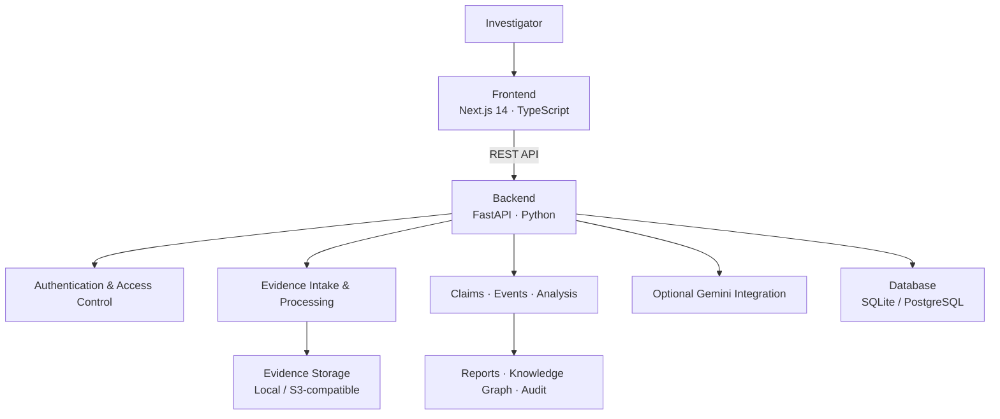

# EvidenceX

### One Case. Multiple Evidence Formats. Connected Findings.

**EvidenceX is a multimodal evidence intelligence and investigation workspace that transforms documents, images, audio, video, emails, and spreadsheets into traceable claims, connected events, timelines, and potential inconsistencies — all within one investigation.**

Instead of examining evidence files individually, investigators can bring different formats together, trace every extracted finding back to its original source, and review relationships between pieces of evidence through a unified workspace.

> **Built for Kiroween 2026 — Frankenstein Category, using the Kiro AI IDE.**

---

## The Problem

Investigations often involve evidence scattered across multiple formats: PDF reports, scanned documents, photographs, audio recordings, videos, emails, and spreadsheets.

Manually reviewing each file makes it difficult to:
- Find relevant information across different evidence sources.
- Connect statements, dates, people, places, and events.
- Identify conflicting accounts or potentially inconsistent details.
- Verify where a particular finding originated.
- Maintain a clear record of investigative decisions.

## The Solution

EvidenceX brings these formats into a single investigation workflow.

It extracts information while preserving source references, organizes relevant statements into claims, connects related entities and events, and surfaces possible inconsistencies for human review.

**Every finding remains traceable to its original evidence. Every important decision remains under human control.**

---

## Key Features

| Feature | What it does |
|---|---|
| **Multimodal Evidence Intake** | Accepts PDFs, images, audio, video, emails, CSV, and XLSX files. |
| **Evidence Validation** | Detects actual file types from their contents, applies file-size limits, and stores evidence using SHA-256 content addressing. |
| **Text & OCR Extraction** | Extracts PDF text and uses OCR for scanned pages and images. |
| **Audio Transcription** | Uses local Faster-Whisper speech recognition to convert supported audio into timestamped text. |
| **Video Analysis** | Samples video frames, extracts visible text, and processes the soundtrack as audio. |
| **Claim Extraction** | Identifies statements containing dates, times, quantities, identifiers, and locations. |
| **Entity Linking** | Connects identical identifiers and suggests possible matches without automatically merging similar entities. |
| **Event Reconstruction** | Groups potentially related claims into proposed events for reviewer confirmation. |
| **Timeline** | Organizes relevant events and claims chronologically while preserving source precision. |
| **Contradiction Analysis** | Compares accounts within confirmed events and surfaces possible inconsistencies with alternative explanations. |
| **Knowledge Graph** | Visualizes relationships between evidence, claims, entities, and events. |
| **Source-Based Ask & Search** | Finds relevant source passages and provides answers with citations. |
| **Investigation Reports** | Generates versioned PDF reports and graph exports in JSON and GraphML formats. |
| **Audit Trail** | Records decisions in a SHA-256-chained, tamper-evident audit trail. |
| **Role-Based Access** | Supports owner, editor, reviewer, and viewer roles with server-side permission checks. |

---

## How EvidenceX Works

The investigation follows a traceable processing pipeline:

flowchart LR
    U(["Investigator"]) --> FE["Frontend<br/>Next.js 14 · React · TypeScript"]

    FE -->|"REST API"| BE["Backend<br/>FastAPI · Python"]

    BE --> PROC["Evidence Processing<br/>PDF · OCR · Audio · Video<br/>Email · Spreadsheets"]

    BE --> ANA["Analysis Engine<br/>Claims · Entities · Events<br/>Timeline · Contradictions"]

    BE --> AI["Optional AI<br/>Google Gemini"]

    BE --> DB[("Database<br/>SQLite / PostgreSQL")]

    PROC --> ST[("Evidence Storage<br/>Local / S3")]

    ANA --> OUT["Outputs<br/>Reports · Knowledge Graph<br/>JSON · GraphML · Audit Trail"]

    classDef user fill:#7C3AED,stroke:#5B21B6,color:#FFFFFF,stroke-width:2px
    classDef frontend fill:#DBEAFE,stroke:#2563EB,color:#1E3A8A,stroke-width:2px
    classDef backend fill:#CCFBF1,stroke:#0D9488,color:#134E4A,stroke-width:2px
    classDef processing fill:#FEF3C7,stroke:#D97706,color:#78350F,stroke-width:2px
    classDef analysis fill:#FCE7F3,stroke:#DB2777,color:#831843,stroke-width:2px
    classDef ai fill:#EDE9FE,stroke:#7C3AED,color:#4C1D95,stroke-width:2px
    classDef storage fill:#DCFCE7,stroke:#16A34A,color:#14532D,stroke-width:2px
    classDef output fill:#FFEDD5,stroke:#EA580C,color:#7C2D12,stroke-width:2px

    class U user
    class FE frontend
    class BE backend
    class PROC processing
    class ANA analysis
    class AI ai
    class DB,ST storage
    class OUT output

    linkStyle default stroke:#94A3B8,stroke-width:2px


### The Core Principle: Evidence Provenance

EvidenceX does not simply extract text and discard its origin.

Every extracted segment retains a physical source locator:

- **PDF:** Page number and bounding box.
- **Images:** Pixel region.
- **Audio:** Start and end timestamps, including word timing where available.
- **Video:** Frame timestamp and text region.
- **CSV:** Row and column.
- **Excel:** Sheet and cell.
- **Email:** Header or message part.

Claims reference their source segments, and findings reference the claims on which they are based. This makes it possible to trace an analytical result back to the original evidence.

---

## Supported Evidence Formats

| Evidence type | Supported formats | Processing |
|---|---|---|
| Documents | `.pdf` | Text extraction and OCR fallback for scanned pages |
| Images | `.png`, `.jpg`, `.jpeg`, `.webp` | OCR, orientation correction, and deskew |
| Audio | `.wav`, `.mp3`, `.m4a` | Local Faster-Whisper transcription |
| Video | `.mp4`, `.mov`, `.webm` | Sampled frame extraction, OCR, and soundtrack transcription |
| Email | `.eml` | Header and message-part extraction |
| Spreadsheets | `.csv`, `.xlsx` | Table, row, column, sheet, and cell extraction |

**Optional processing dependencies:**
- Tesseract OCR is required for image OCR and scanned PDF pages.
- The backend `audio` extra and a downloaded Whisper model are required for audio and video speech recognition.
- Missing optional dependencies produce a clear processing status without preventing unrelated evidence from being processed.

---

## Short Architecture

EvidenceX follows a **modular monolith architecture with two deployable applications communicating over REST APIs**.



### Technology Stack

| Layer | Technologies |
|---|---|
| Frontend | Next.js 14, React 18, TypeScript, Tailwind CSS |
| Backend | Python 3.11+, FastAPI, Pydantic v2 |
| Database | SQLAlchemy 2, SQLite, PostgreSQL support, Alembic |
| Document Processing | PyMuPDF, Pillow, Tesseract OCR |
| Audio & Video | Faster-Whisper, PyAV |
| Spreadsheet Processing | OpenPyXL |
| AI Integration | Google Gemini — optional, consent-controlled |
| Graph & Export | NetworkX, GraphML, JSON, PDF |
| Storage | SHA-256 content-addressed local storage and S3-compatible storage |
| Deployment | Docker Compose, Caddy, Vercel deployment configuration |

### Processing and AI Design

- Rule-based claim extraction is the default.
- Gemini-assisted claim extraction, Ask responses, and report summaries are optional and require configuration and case-level consent.
- AI-generated output is schema-validated and labelled.
- Entity resolution, event proposals, and inconsistency detection are rule-based.
- Similar identifiers are never merged automatically.
- Investigators must review proposed events and possible inconsistencies.

---

## Getting Started

### Prerequisites

- Python 3.11 or newer
- Node.js 22.6 or newer
- Git
- Optional: Tesseract OCR
- Optional: FFmpeg-capable PyAV and a downloaded Whisper model for audio/video processing

### 1. Clone the Repository

```bash
git clone https://github.com/krinachauhan006/EvidenceX.git
cd EvidenceX
```

### 2. Set Up the Backend

```powershell
cd backend

python -m venv .venv
.venv\Scripts\activate

pip install -e ".[dev]"

copy .env.example .env

alembic upgrade head

uvicorn app.main:app --host 127.0.0.1 --port 8000
```

For audio and video processing, install the optional dependencies:

```powershell
pip install -e ".[dev,audio]"
```

Download the Whisper model separately when required:

```powershell
python -m app.tools.fetch_whisper_model --size base
```

Backend API documentation:

`http://localhost:8000/docs`

### 3. Set Up the Frontend

Open a second terminal:

```powershell
cd frontend

npm ci

copy .env.local.example .env.local
```

Configure the local API URL in `.env.local`:

```env
NEXT_PUBLIC_API_BASE_URL=http://localhost:8000
```

Start the frontend:

```powershell
npm run dev
```

Open:

`http://localhost:3000`

Create an account, start an investigation, and upload your evidence files.

For additional configuration, database, deployment, and troubleshooting instructions, refer to the documentation below.

---

## Repository Structure

```text
EvidenceX/
│
├── backend/
│   ├── app/
│   │   ├── core/          # Configuration, database and application core
│   │   ├── modules/       # Authentication, cases, evidence and analysis
│   │   ├── processing/    # Evidence extraction and processing
│   │   ├── ai/            # Optional Gemini integration
│   │   └── storage/       # Evidence storage
│   ├── alembic/           # Database migrations
│   └── tests/             # Backend tests
│
├── frontend/
│   ├── app/               # Next.js application routes
│   ├── components/        # UI components and evidence viewers
│   ├── lib/               # API client, types and utilities
│   └── tests/             # Frontend tests
│
├── docs/                  # Architecture, security and deployment guides
├── deploy/                # Deployment configuration
├── sample-evidence/       # Fictional investigation and test evidence
├── .kiro/                 # Kiro steering documents and specifications
│
├── docker-compose.yml
├── docker-compose.prod.yml
├── LICENSE
└── README.md
```

---

## Sample Investigations

The [`sample-evidence/`](sample-evidence/) directory contains fictional evidence datasets for exploring and testing EvidenceX.

It includes investigation scenarios and files intended to demonstrate evidence extraction, cross-referencing, source traceability, and rejection or failure handling.

Use these samples to understand how different evidence formats can contribute to one investigation.

---

## Testing & Verification

EvidenceX includes automated backend and frontend tests.

**Backend:**

```powershell
cd backend
.venv\Scripts\python.exe -m pytest -q
```

**Frontend:**

```powershell
cd frontend
npm run typecheck
npm run lint
node --experimental-strip-types --no-warnings --test tests/*.test.mjs
```

### Implementation Transparency

Some integrations and deployment paths have additional verification requirements:

- Gemini-assisted features have mocked test coverage but have not been verified against the live Gemini API in the documented test status.
- OCR requires Tesseract on the processing host.
- Audio and video speech recognition require the optional audio dependencies and a downloaded model.
- The Vercel deployment configuration is documented separately; serverless environments do not provide all local OCR, audio, and video processing engines.
- Docker production files require a full staging build and deployment trial before being treated as production-verified.

See the [deployment documentation](docs/DEPLOYMENT.md) and [Vercel deployment guide](docs/VERCEL_DEPLOYMENT.md) for the detailed status and limitations.

---

## Security & Responsible Use

EvidenceX is designed around traceability, controlled access, and human oversight.

- File types are validated using file contents rather than extensions alone.
- Evidence is stored using SHA-256 content addressing outside web-served directories.
- Uploaded files are not executed.
- Email attachments are listed but not automatically opened.
- Spreadsheet formulas are displayed but never executed.
- Authentication, session handling, CSRF checks, and server-side role permissions protect application operations.
- Audit records are linked using a SHA-256 hash chain.
- EvidenceX does not automatically decide whether a claim is true or whether an inconsistency represents misconduct.

**Important:** EvidenceX is an analytical aid, not a forensic certification or legal decision-making system. It does not determine guilt or innocence, detect lies, or authenticate evidence. OCR, transcription, extraction, and heuristic confidence values can contain errors and must be independently reviewed before use in consequential decisions.

For more details, see [Security & Privacy](docs/SECURITY.md).

---

## Documentation

| Document | Description |
|---|---|
| [Architecture](docs/ARCHITECTURE.md) | Internal modules, processing pipeline, and provenance model |
| [Deployment Guide](docs/DEPLOYMENT.md) | Docker deployment, backup, restore, and upgrades |
| [Vercel Deployment](docs/VERCEL_DEPLOYMENT.md) | Frontend, backend, managed database, and S3-compatible storage |
| [Security & Privacy](docs/SECURITY.md) | Security controls and data handling |
| [Third-Party Licences](docs/THIRD_PARTY_LICENSES.md) | Licences and notices for external dependencies |
| [Demo Guide](docs/DEMO.md) | Demonstration workflow |
| [API Documentation](http://localhost:8000/docs) | Interactive FastAPI / OpenAPI documentation when running locally |

---

## Licence

EvidenceX is licensed under the **GNU Affero General Public License v3.0 (AGPL-3.0)**.

You may use, study, modify, and redistribute the software under the terms and conditions of this licence.

Under the AGPL-3.0, if you modify EvidenceX and make that modified version available for users to interact with over a network, you must also provide those users access to the corresponding source code under the applicable licence terms.

The licence applies to EvidenceX's own code. Third-party libraries, tools, and assets remain subject to their respective licences.

See the [`LICENSE`](LICENSE) file for the complete licence text and [`docs/THIRD_PARTY_LICENSES.md`](docs/THIRD_PARTY_LICENSES.md) for third-party notices.

**Copyright (C) 2026 Krina R. Chauhan**

---

<p align="center">
  <strong>EvidenceX</strong><br/>
  One Case. Multiple Evidence Formats. Connected Findings.
</p>

<p align="center">
  Built with care for more transparent, traceable, and human-reviewed investigations.
</p>
